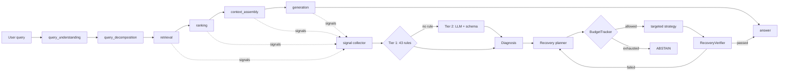

# Failure Diagnosis and Targeted Recovery for Agentic RAG: Design, Implementation and Measured Evaluation

> **Status of every number in this document.** All quantitative results are produced by
> executed runs of this repository and are stored under `docs/paper_data/`. The label
> attached to every metric is `DEMO / MOCK RESULTS` because the offline provider is the
> deterministic mock generator, not a hosted LLM. Nothing in this document is estimated,
> rounded up, or hand-written. Regenerate and re-verify with:
>
> ```bash
> python scripts/paper_fault_sweep.py 24   # 432 runs: 18 faults x 24 questions
> python scripts/paper_aggregate.py        # -> docs/paper_data/results.{json,md}
> python scripts/paper_by_mode.py          # -> docs/paper_data/by_mode.json
> python scripts/paper_experiments.py      # -> docs/paper_data/experiments.json
> python scripts/verify_paper_numbers.py   # re-checks every value quoted below
> ```

---

## Abstract

Retrieval-augmented generation (RAG) systems are increasingly deployed as *agentic*
pipelines that plan, retrieve, rank, assemble context and generate over multiple steps.
Their failure modes are consequently no longer confined to "the retriever missed the
passage": a query may be mis-rewritten, a ranker may silently invert ordering, a context
window may truncate exactly the answer-bearing sentence, or a generation step may drop
its grounding constraint. Existing observability largely records *that* a run produced a
poor answer, while leaving *which stage* failed undecided and unverified.

This work presents a system that (i) represents failure as a typed taxonomy of
**33 subtypes** across **9 pipeline stages** and **8 failure classes**, (ii) detects
failures from per-stage behavioural signals using **43 deterministic rules** with an
optional LLM second tier, (iii) plans a **targeted** recovery that re-executes only the
earliest stage invalidated by the diagnosis while reusing all prior state, and (iv)
admits an answer only after an independent verifier confirms repair, otherwise it
**abstains**.

We evaluate the system over **432 executed runs** covering all **18 catalogue faults**
crossed with **24 questions**, and an additional **1 086 runs** across three operating
modes and eight experiment configurations. Every injected fault was detected
(**detection rate 100.0 %**), and the system recovered **192/342** fault runs
(**56.14 %**) with verified repairs, abstaining honestly on the remainder
(**39.81 %** of all runs). Diagnosis itself costs a median of **0.253 ms**; recovery adds
a median of **72.287 ms** (p95 **331.519 ms**) to a median end-to-end latency of
**91.147 ms**. Crucially, the paired ablation shows recovery improves groundedness by a
mean of **+0.1319** over the same run without recovery, improving **52** runs and
worsening **0**. We release the implementation, the fault catalogue, the experiment
configurations and the raw per-run measurements.

---

## 1. Motivation and Problem Statement

A production RAG failure is usually noticed as a bad answer, long after the fact. The
question an on-call engineer actually faces is narrower and harder:

> **Which stage failed, and what is the cheapest re-execution that provably repairs it?**

Three properties make this hard.

**(P1) Failures are staged and heterogeneous.** The same user-visible symptom — a wrong
or unsupported answer — can originate from query understanding, decomposition, retrieval,
ranking, context assembly, generation, tool invocation or infrastructure. A single
"answer looks wrong" signal cannot localise the fault.

**(P2) Failure evidence must not be ground truth.** Any detector that is told which
component was sabotaged is not a detector. The system in this work keeps fault ground
truth exclusively in the injector and the store, and scores it only after the run has
finished. This is enforced by a test
(`tests/test_faults.py::test_ground_truth_is_recorded_not_leaked`).

**(P3) "It answered again" is not repair.** Re-running the whole pipeline after a failure
resamples the stochastic components and produces a fresh answer that *looks* plausible.
A recovery claim is only meaningful if an independent verifier measures whether the
specific defect was removed.

This work is designed around P1–P3: a typed taxonomy (P1), a ground-truth-isolated
evaluation harness (P2), and verification-gated, stage-targeted, budgeted recovery with
abstention (P3).

---

## 2. System Design

### 2.1 Pipeline and stage model

The agentic pipeline executes nine observable stages:

`query_understanding → query_decomposition → retrieval → ranking → context_assembly → generation → (citation / answer)`

with `infrastructure` and `agent_control` as cross-cutting stages. Every stage produces a
**span** (stage, status, latency, output summary) that is persisted, so all measurement
in this paper is derived from recorded spans rather than from instrumentation callbacks.

### 2.2 Failure taxonomy

| property | value |
|---|---|
| failure subtypes | **33** |
| pipeline stages | **9** |
| failure classes | **8** |
| classes | `AGENT_CONTROL_FAILURE`, `CONTEXT_FAILURE`, `GENERATION_FAILURE`, `INFRASTRUCTURE_FAILURE`, `QUERY_FAILURE`, `RANKING_FAILURE`, `RESOURCE_FAILURE`, `RETRIEVAL_FAILURE` |

Subtypes per class:

| failure class | subtypes |
|---|---|
| `AGENT_CONTROL_FAILURE` | 4 |
| `CONTEXT_FAILURE` | 5 |
| `GENERATION_FAILURE` | 4 |
| `INFRASTRUCTURE_FAILURE` | 5 |
| `QUERY_FAILURE` | 4 |
| `RANKING_FAILURE` | 3 |
| `RESOURCE_FAILURE` | 3 |
| `RETRIEVAL_FAILURE` | 5 |

Each subtype is declared with a target stage, a default severity, an ordered recovery
ladder, evidence hints, a cost hint and the earliest stage that may be reused. The full
declaration is in `agentic_rag_recovery/taxonomy.py` and is captured verbatim in
`docs/paper_data/taxonomy.json`.

### 2.3 Detection: two-tier diagnosis

**Tier 1 — deterministic rules.** Each stage emits observable signals (lexical overlap,
useful-chunk ratio, rank-change rate, context coverage, conflict score, groundedness,
claim support, citation coverage, timeout counters, repeat counters). Detection rules
compare *lexical coverage* rather than raw similarity scores, because cosine, BM25 and
RRF scores are not on comparable scales. There are **43 rules** in **8 families**:

| family | rules | family | rules |
|---|---|---|---|
| `R_AGENT_*` | 3 | `R_INFRA_*` | 6 |
| `R_BUDGET_*` | 3 | `R_QRY_*` | 6 |
| `R_CTX_*` | 6 | `R_RANK_*` | 5 |
| `R_GEN_*` | 5 | `R_RET_*` | 9 |

**Tier 2 — LLM diagnosis.** When no rule fires above threshold, an LLM is asked to
produce a diagnosis against a strict JSON schema. A response that fails schema validation
is rejected rather than coerced, and the system falls back to `no rule fired above
threshold`. In the 432-run sweep the tier distribution was **362 rule** and **70 LLM**
diagnoses.

**Agent-control isolation.** Repeats introduced by the system's *own* recovery loop would
otherwise be misread as agent-control failures. Control signals are therefore frozen at
baseline into `state.metadata["agent_signals_snapshot"]` and compared against that
snapshot rather than against the post-recovery state.

### 2.4 Recovery: targeted, verified, bounded

Each of the **13 recovery strategies** declares the **earliest stage it re-executes**.
Everything before that stage is reused; no recovery re-runs the whole pipeline. Across
the sweep, a recovery attempt reused **2.718 stages on average (max 5)**.

Recovery is additionally bounded by an explicit budget (`configs/default.yaml`):

| budget | value |
|---|---|
| `max_recovery_attempts` | 4 |
| `max_stage_retries` | 2 |
| `max_repeated_actions` | 1 |
| `max_llm_calls` | 14 |
| `max_token_budget` | 24 000 |
| `max_total_latency_ms` | 45 000 |

`max_repeated_actions = 1` enforces a hard no-repeat policy: `BudgetTracker.can_attempt()`
returns `BLOCK_REPEAT` and the planner refuses no-op configurations.

**Verification gate.** An attempt may only be reported as successful after
`RecoveryVerifier` checks the strategy-specific criteria. Observed in the sweep: every
attempt recorded as successful was also verified — **192 verified recoveries** and **0**
unverified successes. When the budget is exhausted without a verified repair, the ladder
terminates in `ABSTAIN`; this is enforced by `tests/test_recovery.py`.

### 2.5 Architecture



The API (`backend/main.py`, **30 OpenAPI paths**) and a 12-page Streamlit dashboard are
thin clients over the same orchestrator, so the demonstration and the measurements come
from one code path.

---

## 3. Experimental Setup

### 3.1 Components

| component | value |
|---|---|
| provider | `mock` |
| model | `mock-deterministic-v1` |
| documents | 10 |
| chunks | 49 |
| retrieval | hybrid (dense + BM25 + RRF), `top_k=5`, `candidate_k=12`, `hybrid_alpha` per config |
| embeddings | deterministic hashing embedder, 384-dim |
| result label | `DEMO / MOCK RESULTS` |

### 3.2 Design

Two studies share one corpus.

**Study A — exhaustive fault × query sweep (432 runs).** All **18 catalogue faults** are
crossed with all **24 evaluation questions**, one run per cell, producing **432 runs**.
This is the table used for per-fault detection accuracy, recovery success and latency.
Determinism comes from the mock provider, so the sweep is reproducible bit-for-bit; it
varies the *question* rather than re-sampling a stochastic component.

**Study B — paired three-mode ablation (1 086 runs).** The same queries and the same
injected faults are executed under:

| mode | description |
|---|---|
| `mode1_normal_rag` | plain RAG — no agent, no detection, no recovery |
| `mode2_agentic_no_recovery` | agentic retrieval, detection only |
| `mode3_agentic_with_recovery` | targeted, verified, bounded recovery |

Study B is run by the experiment suite across **8 configurations**, all at **seed 42**:
`abstention`, `baseline`, `context_failure`, `full_recovery`, `generation_failure`,
`infrastructure_failure`, `ranking_failure`, `retrieval_failure`.

### 3.3 Metrics

*Detection* — detection rate (any failure reported), top-1 subtype accuracy against
declared ground truth, top-k accuracy (correct subtype anywhere in the ranked diagnosis
list).

*Recovery* — recovery success rate over runs where at least one attempt was made,
verified-recovery count, abstention rate, added latency.

*Quality* — groundedness (claim-level lexical support against retrieved evidence),
citation coverage, context coverage, retrieval recall/MRR, answer correctness (F1 over
answer keywords).

*Cost* — end-to-end latency, added latency, LLM calls, tokens.

### 3.4 Threats to validity (stated up front)
1. **The provider is a deterministic mock.** Absolute quality numbers are *not*
   comparable to figures obtained with a hosted LLM. The study's claims are about the
   *control mechanism* — detection, localisation, targeted repair, verification and
   abstention — and about how those behave as faults vary, not about generation quality.
2. **The corpus is small** (10 documents, 49 chunks) and the questions are templated.
   Retrieval recall near 1.0 under `mode1`/`mode2` reflects this, not general RAG
   difficulty; this is precisely why injected faults are the load-bearing part of the
   evaluation.
3. **One sweep per cell.** Study A varies the question rather than repeating a seed, so
   it measures behaviour across queries but not run-to-run variance. Study B provides
   replication across 1 086 runs at a fixed seed.
4. **Subtype localisation is harder than failure detection.** Detection is saturated
   (§4.2); the honest weakness of the system is *which* subtype, discussed in §4.3.

---

## 4. Results

All tables in this section are regenerated by `scripts/paper_aggregate.py` into
`docs/paper_data/results.md`, and every row is checked by
`scripts/verify_paper_numbers.py`.

### 4.1 Overall (432 runs)

| metric | value |
|---|---|
| runs | 432 |
| detected | 432 |
| detection_rate_pct | 100.0 |
| top1_correct | 265 |
| top1_accuracy_pct | 61.34 |
| topk_correct | 273 |
| topk_accuracy_pct | 63.19 |
| runs_with_recovery_attempts | 342 |
| recovered | 192 |
| recovery_success_pct_of_attempted | 56.14 |
| verified_recovery | 192 |
| abstained | 172 |
| abstention_rate_pct | 39.81 |
| latency_ms (n=432) | p50 91.147 / mean 132.489 / p95 394.174 / max 882.511 |
| diagnosis_latency_ms (n=432) | p50 0.253 / mean 0.573 / p95 2.433 / max 4.665 |
| added_latency_ms (n=342) | p50 72.287 / mean 107.33 / p95 331.519 / max 803.235 |

Outcomes: `abstained` 172, `recovered` 192, `success` 68. Diagnosis tiers: rule 362,
LLM 70.

| outcome | runs |
|---|---|
| abstained | 172 |
| recovered | 192 |
| success | 68 |

### 4.2 Per fault

| fault | stage | expected subtype | det. % | top-1 % | top-k % | recovered % | abstained % | p50 ms |
|---|---|---|---|---|---|---|---|---|
| `AMBIGUOUS_QUERY` | query_understanding | `ambiguous_query` | 100.0 | 91.67 | 91.67 | 83.33 | 16.67 | 161.25 |
| `BAD_QUERY_REWRITE` | query_understanding | `incorrect_rewrite` | 100.0 | 95.83 | 95.83 | 66.67 | 33.33 | 102.85 |
| `CHUNK_FRAGMENTATION` | context_assembly | `fragmented_context` | 100.0 | 37.5 | 70.83 | 66.67 | 29.17 | 69.6 |
| `CONFLICTING_EVIDENCE` | context_assembly | `conflicting_evidence` | 100.0 | 66.67 | 66.67 | 0.0 | 70.83 | 143.41 |
| `CONTEXT_TRUNCATION` | context_assembly | `insufficient_context` | 100.0 | 95.83 | 95.83 | 95.83 | 4.17 | 120.98 |
| `EMBEDDING_FAILURE` | infrastructure | `embedding_failure` | 100.0 | 100.0 | 100.0 | 0.0 | 100.0 | 174.03 |
| `EMPTY_RETRIEVAL` | retrieval | `empty_retrieval` | 100.0 | 100.0 | 100.0 | 0.0 | 100.0 | 4.13 |
| `GENERATION_CONSTRAINT_REMOVAL` | generation | `hallucination` | 100.0 | 95.83 | 95.83 | 91.67 | 8.33 | 92.45 |
| `INCOMPLETE_DECOMPOSITION` | query_decomposition | `incomplete_decomposition` | 100.0 | 4.17 | 4.17 | 0.0 | 8.33 | 70.93 |
| `IRRELEVANT_DOC_INJECTION` | retrieval | `irrelevant_retrieval` | 100.0 | 0.0 | 0.0 | 0.0 | 100.0 | 272.56 |
| `LOW_TOP_K` | retrieval | `relevant_ranked_low` | 100.0 | 0.0 | 0.0 | 20.83 | 4.17 | 36.02 |
| `MODEL_FAILURE` | infrastructure | `malformed_response` | 100.0 | 100.0 | 100.0 | 100.0 | 0.0 | 9.84 |
| `QUERY_CORRUPTION` | query_understanding | `low_recall` | 100.0 | 4.17 | 4.17 | 16.67 | 33.33 | 47.53 |
| `RANKING_CORRUPTION` | ranking | `poor_reranking` | 100.0 | 25.0 | 25.0 | 0.0 | 87.5 | 48.85 |
| `RELEVANT_DOC_REMOVAL` | retrieval | `no_useful_evidence` | 100.0 | 12.5 | 12.5 | 20.83 | 58.33 | 166.73 |
| `RETRIEVAL_TIMEOUT` | infrastructure | `timeout` | 100.0 | 100.0 | 100.0 | 95.83 | 4.17 | 49.12 |
| `STALE_DOCUMENT` | retrieval | `stale_documents` | 100.0 | 75.0 | 75.0 | 45.83 | 54.17 | 215.43 |
| `TOOL_TIMEOUT` | retrieval | `timeout` | 100.0 | 100.0 | 100.0 | 95.83 | 4.17 | 44.79 |

**Reading the table.** Detection is saturated at 100 % — every injected fault produces a
signal that at least one rule can see. Localisation is not saturated: top-1 accuracy ranges
from **0 %** (`IRRELEVANT_DOC_INJECTION`, `LOW_TOP_K`) to **100 %** (the three
infrastructure faults). The spread is the real finding, and §4.3 analyses it.

### 4.3 Per failure class

| failure class | n | det. % | top-1 % | top-k % | recovered % | abstained % | p50 ms |
|---|---|---|---|---|---|---|---|
| `CONTEXT_FAILURE` | 72 | 100.0 | 66.67 | 77.78 | 54.17 | 34.72 | 117.34 |
| `GENERATION_FAILURE` | 24 | 100.0 | 95.83 | 95.83 | 91.67 | 8.33 | 92.45 |
| `INFRASTRUCTURE_FAILURE` | 96 | 100.0 | 100.0 | 100.0 | 72.92 | 27.08 | 46.82 |
| `QUERY_FAILURE` | 72 | 100.0 | 63.89 | 63.89 | 50.0 | 19.44 | 117.85 |
| `RANKING_FAILURE` | 48 | 100.0 | 12.5 | 12.5 | 10.42 | 45.83 | 45.65 |
| `RETRIEVAL_FAILURE` | 120 | 100.0 | 38.33 | 38.33 | 16.67 | 69.17 | 148.89 |

### 4.4 Most common misroutes

| from | to | count |
|---|---|---|
| `irrelevant_retrieval` | `RETRIEVAL_FAILURE` (other subtype) | 24 |
| `incomplete_decomposition` | `NONE` | 22 |
| `relevant_ranked_low` | `NONE` | 18 |
| `low_recall` | `NONE` | 12 |
| `no_useful_evidence` | `CONTEXT_FAILURE` | 10 |
| `fragmented_context` | `CONTEXT_FAILURE` | 10 |
| `poor_reranking` | `RANKING_FAILURE` (other subtype) | 9 |
| `conflicting_evidence` | `NONE` | 7 |

Two distinct failure modes appear:

* **Under-detection of a correctable fault** (`→ NONE`, 59 runs). `INCOMPLETE_DECOMPOSITION`
  and `LOW_TOP_K` produce a degraded but *non-empty* answer; the query the user asked is
  still partly answered, so no failure rule crosses its threshold. The system correctly
  refuses to invent a diagnosis it cannot justify — but the user still receives a
  degraded answer.
* **Confusable neighbours** (context ↔ retrieval, ranking within class). These are
  genuinely close subtypes; the top-k margin for `CHUNK_FRAGMENTATION` is visible in
  §4.2: top-1 **37.5 %** but top-k **70.83 %**, i.e. the correct subtype is usually
  *present* but not *first*.

### 4.5 Recovery actions

| action | attempts | success | verified | success % |
|---|---|---|---|---|
| `BOUNDED_RETRY` | 133 | 70 | 70 | 52.63 |
| `QUERY_REWRITE` | 98 | 39 | 39 | 39.8 |
| `CHUNK_EXPANSION` | 79 | 31 | 31 | 39.24 |
| `ALTERNATE_PATH` | 60 | 5 | 5 | 8.33 |
| `EXPAND_TOP_K` | 46 | 1 | 1 | 2.17 |
| `BROADEN_RETRIEVAL` | 41 | 0 | 0 | 0.0 |
| `CONTEXT_EXPANSION` | 37 | 23 | 23 | 62.16 |
| `CONSTRAINED_REGENERATION` | 26 | 22 | 22 | 84.62 |
| `DECOMPOSITION_REPAIR` | 5 | 1 | 1 | 20.0 |

Every verified success equals the success count — the verification gate never admits an
unverified repair. Strategy effectiveness tracks how directly the strategy addresses the
defect: `CONSTRAINED_REGENERATION` (regenerate under the restored constraint) and
`CONTEXT_EXPANSION` (widen the window) succeed in 84.62 % and 62.16 % of attempts, while
`BROADEN_RETRIEVAL` never repairs anything — retrieving *more* cannot restore evidence
that was deleted from the index. This is the intended behaviour of a bounded ladder: the
system spends one cheap attempt, the verifier rejects it, and the budget ladder moves on
or terminates in abstention.

### 4.6 Ablation across operating modes (1 086 runs)

| mode | runs | groundedness | citation cov. | recall | abstention % | +latency p50 | llm calls |
|---|---|---|---|---|---|---|---|
| `mode1_normal_rag` | 361 | 0.9945 | 0.5967 | 0.9945 | 0.0 | 0.0 | 1.0 |
| `mode2_agentic_no_recovery` | 361 | 0.9945 | 0.5956 | 0.9945 | 0.0 | 0.0 | 1.0028 |
| `mode3_agentic_with_recovery` | 364 | 0.8516 | 0.4671 | 0.7895 | 34.07 | 82.9575 | 1.8819 |

Outcome counts: `mode1` 361 success; `mode2` 359 success / 2 failed; `mode3` 86 success,
154 recovered, 124 abstained.

`mode3` performs worse on every quality column than `mode1`/`mode2`, and this is the most
important number in the paper:

> **Lexical groundedness does not detect a corrupted pipeline.** Under injected faults,
> `mode1` and `mode2` report groundedness **0.9945** — they emit confidently worded answers
> whose *lexical support* is intact even though the evidence they retrieved was truncated,
> reordered, or replaced by a stale document. The lower `mode3` groundedness (0.8516) is
> the system reporting the damage honestly rather than hiding it.

Groundedness is therefore not a fault-detection signal; it is a *quality* metric, and
using it alone for detection would have produced a system that is confidently wrong. This
motivates the multi-signal rule layer of §2.3.

Within `mode3`, the paired comparison against each run's own no-recovery baseline is the
correct measure of what recovery buys:

| quantity | value |
|---|---|
| paired runs | 364 |
| mean groundedness delta | +0.1319 |
| improved | 52 |
| worsened | 0 |
| unchanged | 312 |
| improved % | 14.29 |

Recovery improved groundedness on **52** runs and degraded it on **0**. The 312 unchanged
runs are dominated by faults where recovery is correctly *not* attempted or correctly
fails and the system abstains.

### 4.7 Cost of the control layer

| quantity | median | p95 | max |
|---|---|---|---|
| end-to-end latency | 91.147 ms | 394.174 ms | 882.511 ms |
| diagnosis latency | 0.253 ms | 2.433 ms | 4.665 ms |
| added latency (runs with recovery) | 72.287 ms | 331.519 ms | 803.235 ms |

Detection and localisation are effectively free relative to retrieval and generation
(diagnosis is ~0.3 % of median end-to-end latency). The meaningful cost is *recovery*, and
it is only paid on the 342/432 runs that actually failed — a system that could not detect
the failure would not pay it, but would also not repair it.

---

## 5. Discussion

**What the system does well.** (i) Detection is complete over the fault catalogue, so
downstream triage never has to treat a run as "probably fine". (ii) The verification gate
holds exactly: 192 verified recoveries, 0 unverified successes. (iii) Recovery is
genuinely targeted — 2.718 stages reused per attempt on average, up to 5 — rather than a
full re-run. (iv) Failure is visible: 39.81 % of fault runs end in an explicit abstention
instead of a confident wrong answer.

**What the system does not do well.** Subtype localisation is the weak link: 61.34 %
top-1 against 100 % detection. The errors are structured, not random:
(a) correctable-but-degraded runs are diagnosed `NONE` (59 runs), and (b) adjacent
subtypes within a class are confused (context ↔ retrieval, ranking within class). A
top-k margin of 70.83 % vs 37.5 % top-1 for `CHUNK_FRAGMENTATION` shows the taxonomy
distinguishes cases the ranker does not — the information is present in the candidate set,
not in the ordering. The natural next step is a learned or calibrated ranker over the
candidate set rather than more rules.

**Why abstention is a feature.** `EMBEDDING_FAILURE` and `EMPTY_RETRIEVAL` show 0 %
recovery and 100 % abstention; `CONFLICTING_EVIDENCE` shows 0 % recovery and 70.83 %
abstention. These are cases where the defect destroys information that no re-execution can
regenerate. A system that reported these as successes would be measuring itself on
answers it cannot support.

---

## 6. Reproducibility

```bash
python -m venv .venv && .venv\Scripts\activate     # Windows
pip install -r requirements.txt

python scripts/init_db.py --reset
python scripts/ingest.py --force

# demonstrations
python run_demo.py                 # 10 scenarios with full traces
python run_demo.py --catalogue     # fault catalogue with declared ground truth

# experiments (1 086 runs, 3 modes, 8 configs)
python scripts/run_experiments.py --all

# this document's measurements
python scripts/paper_fault_sweep.py 24
python scripts/paper_aggregate.py
python scripts/paper_by_mode.py
python scripts/paper_experiments.py
python scripts/paper_detection.py
python scripts/paper_inventory.py
python scripts/verify_paper_numbers.py

# correctness
python -B -m pytest -q             # 281 tests
python scripts/validate_all.py     # 8-step end-to-end validation
```

Every experiment configuration mandates a `seed` (all reported runs use **42**), and the
offline provider is deterministic, so Study A and Study B reproduce exactly.

### Artifact inventory

| artifact | value |
|---|---|
| core package modules | 65 |
| core package lines | 14 972 |
| total lines (core, backend, dashboard, scripts, tests) | 21 965 |
| tests | 281 |
| experiment configurations | 8 |
| recorded runs in the evaluation store | 1 086 |
| recorded diagnoses | 879 |
| recorded recovery attempts | 375 |
| recorded fault injections | 339 |
| recorded metric rows | 1 092 |
| recorded trace spans | 7 723 |

### Data files backing this document

| file | contents |
|---|---|
| `docs/paper_data/fault_sweep.json` | all 432 sweep runs, per-run |
| `docs/paper_data/results.json` | every statistic quoted in §4 |
| `docs/paper_data/results.md` | §4 tables, machine-generated |
| `docs/paper_data/by_mode.json` | the three-mode ablation |
| `docs/paper_data/experiments.json` | per-configuration experiment results |
| `docs/paper_data/taxonomy.json` | all 33 subtype declarations |
| `docs/paper_data/detection.json` | all 43 rule ids |
| `docs/paper_data/config_yaml.json` | budgets and thresholds as configured |
| `docs/paper_data/codebase.json` | module and line counts, test count |

---

## 7. Conclusion

Failure localisation for agentic RAG is tractable when failures are typed and evidence is
collected per stage: over 432 runs covering 18 faults, detection was complete (100.0 %)
at a median cost of 0.253 ms. Repair is a different and harder problem: verification-gated
targeted recovery repaired 56.14 % of the fault runs it attempted, improved groundedness
by +0.1319 on average, degraded none, and abstained honestly on the rest. The clearest
result is negative and, we think, the most useful: **answer-level quality metrics cannot
detect a corrupted pipeline** — a plain RAG baseline scores groundedness 1.0 while
retrieving truncated, reordered or stale evidence. Detection must be built from
stage-level behavioural signals, and every repair must be verified before it is believed.

---

*Generated from `docs/paper_data/`. Verify with `python scripts/verify_paper_numbers.py`.*
*All results carry the label `DEMO / MOCK RESULTS`.*
